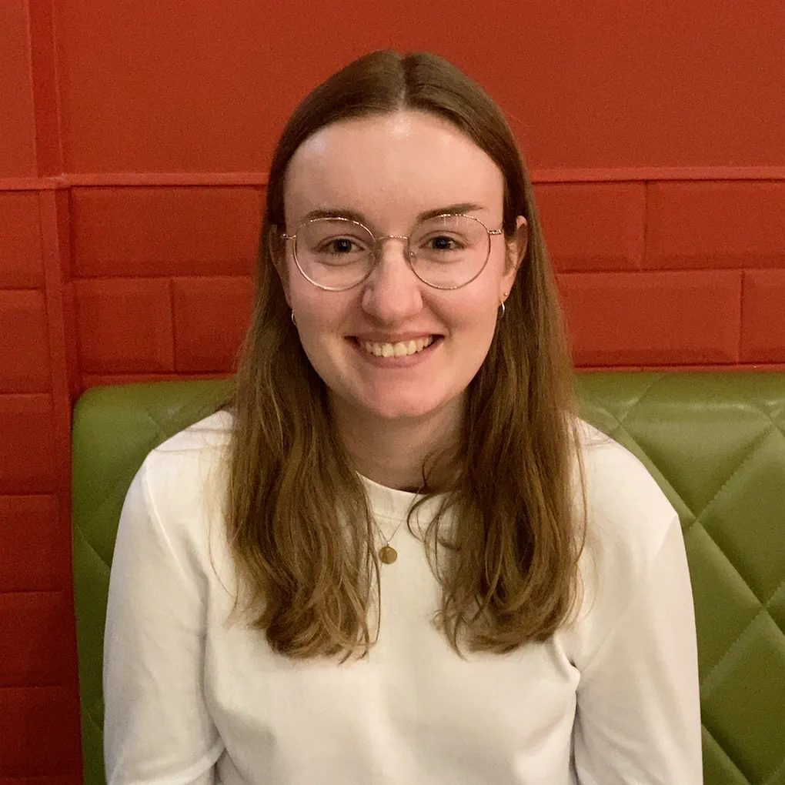

I am a first year PhD student at the University of Bonn under the supervision of [Jan Schröer](https://www.math.uni-bonn.de/~schroer/). Before that I completed my MSc in mathematics at Bonn and did [Part III](https://www.maths.cam.ac.uk/postgrad/part-iii/current) at the University of Cambridge, where I was a member of Magdalene College. My research interests lie in the representation theory of finite-dimensional algebras and quivers. I am interested in their interplay with algebraic geometry, combinatorics and algebraic topology. More specifically, I have recently worked on E-symmetric algebras, pseudocompact algebras and g-vectors. I am co-organising our [Algebra and Representation Theory](https://sites.google.com/view/reptheory-seminar-bonn/home) group seminar in Bonn.

For more information, please find my [CV](files/Carolin_Hartung_CV.pdf) here.

## Contact

Email: hartung [at] math [dot] uni-bonn [dot] de
