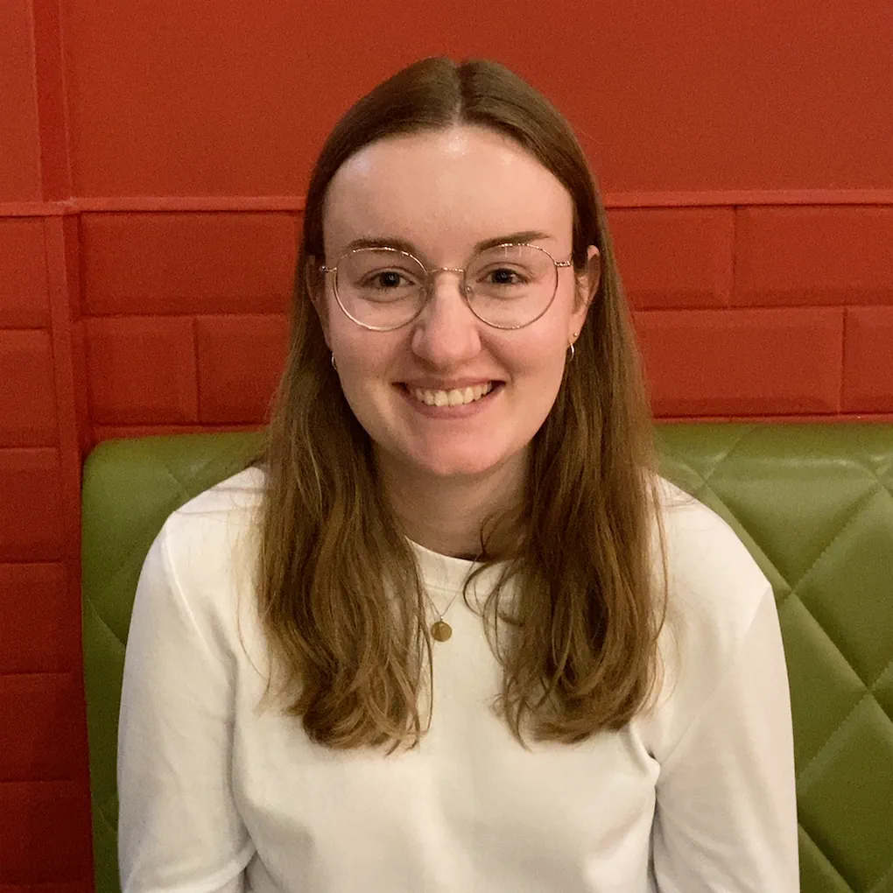

I am a first year PhD student at the University of Bonn under the supervision of [Jan Schröer](https://www.math.uni-bonn.de/~schroer/). Before that I completed my MSc in mathematics at Bonn and did [Part III](https://www.maths.cam.ac.uk/postgrad/part-iii/current) at the University of Cambridge, where I was a member of Magdalene College. My research interests lie in the representation theory of finite-dimensional algebras, quivers and their homological and combinatorial properties. For more information, please find my [CV](https://www.dropbox.com/scl/fi/t295vfbata2c7wephstel/CV_Carolin_Hartung_Website.pdf?rlkey=dpo8kq8k5c3ynfo50l5w7sraz&e=1&st=lvu9pk6y&dl=0) here.

## Contact

Email: hartung [at] math [dot] uni-bonn [dot] de
