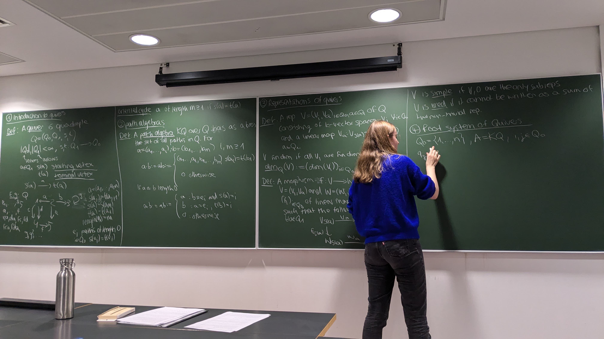

::: {.column-screen}
{.cover-image}
:::

# Talks {#talks-title}

## 2026

1. **Resolution Forests and the Higher Gorenstein property in Nakayama algebras**  
   Algebra and Representation Theory Group Seminar, University of Bonn — July 2026.

2. **E-invariants of quiver algebras**  
   Junior Algebra and Representation Theory Seminar, University of Oxford — May 2026.

3. **Projective Presentations over quasicompact algebras**  
   Algebra and Representation Theory Group Seminar, University of Bonn — April 2026.

4. **Ringel’s homological bijection is stabilized interval free**  
   Algebra and Representation Theory Group Seminar, University of Bonn — February 2026.

## 2024

5. **An introduction to quivers and Gabriel’s theorem**  
   Part III Seminar Series, University of Cambridge — November 2024.

<!-- Titles and dates were retained from your existing website. -->
